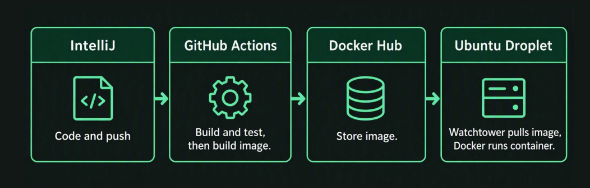
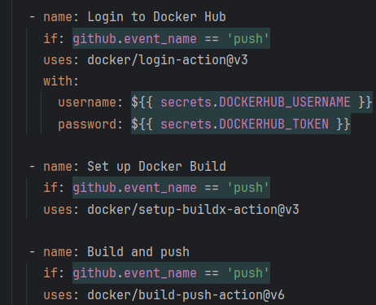

## Dev-ops and deployment

This week we learned about setting up a better structure for our own little linux server, we have on a droplett on Digital Ocean. Now instead of manually creating the Fat-jar file and copy paste it from our local files to the server, we set up a Dockerfile and a workflow.yml file in our project, which is a collection of commands that runs everytime the program is pushed. The new pipeline looks like this now: 

We build the code with our IDE (InteliJ), then we commit and push changes, our program then runs the code in our workflow, for example these lines tells what happens next: 

because the workflow.yml file is in .github/workflows/ GitHub knows to put in the actions page, and the code itself tells what to do with the Fat-jar image after it's build. We put it on Docker-hub where we store it, so we can grab the image from our linux server using secret values for username, password, jwt secret keys and so on.
Also we implemented something called WatchTower, which is a pretty neat open-source tool for Docker that automates the process of updating running Docker-containers. It runs a check in a given interval (like 5min or an hour) and if the current image on docker-hub gets an update WatchTower will automatically pull it to our server.

Deployment was as usual a little complicated and everyone, including myself, ran into a lot of sometimes small sometimes really annoying issues. I've just accepted that when hosting servers something is bound to give you a little headache, but compared to last semester everything was pretty smooth. I've also build three other websites outside of school just as a hobby project, so I feel I've gotten the hang of it a little more.

I got my Chess-API deployed, which was a huge step. I even tested that the endpoints actually work when typing in url and it does! Having no frontend means that every time you see some form of visual proof your program actually exists gives so much joy. I also made some web-socket tests in the program, that uses the deployed website. I've just frantically been trying to add as many features as possible, but I think I've underestimated how long some of the would take. I made the daily-puzzles I fetch from Lichess-api into a playable feature but it took almost all of the available hours I had for my project this week.

Next week is exam-prep-week and I have to make some decisions to cut out some of the features I would've liked to have added. I'm still pretty happy with what I have so far, and after the exam is done I can hopefully implement the power-up feature. But for now I have a working chess-api the can connect two users and play chess and also a user can get a daily puzzle and attempt to solve it.